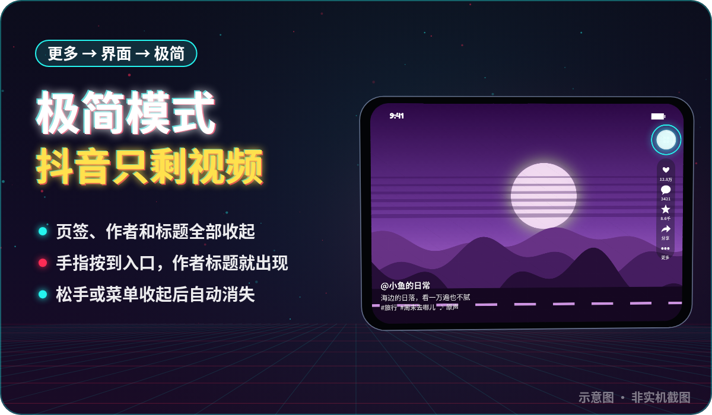
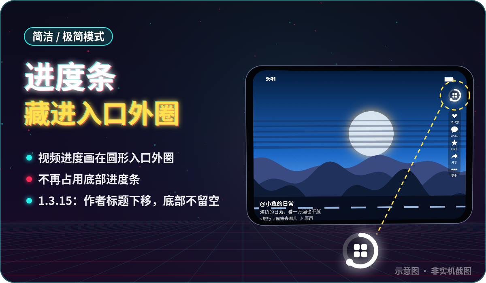
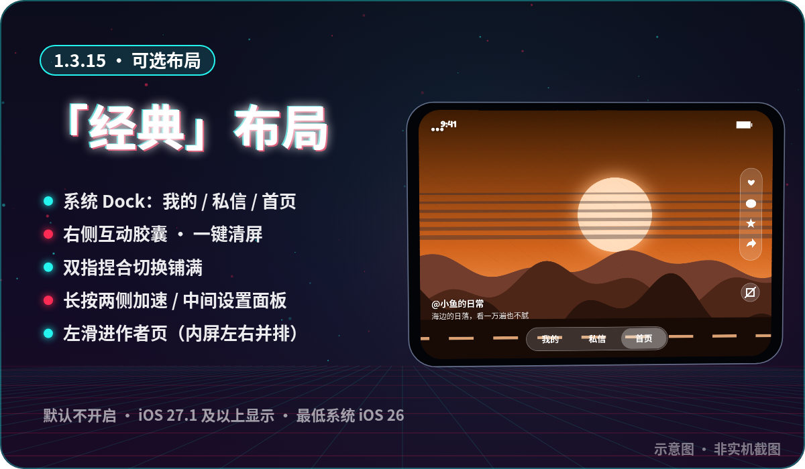
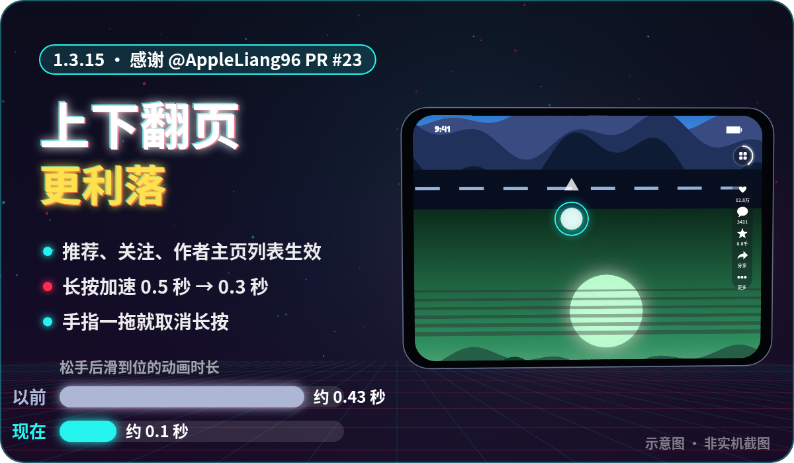
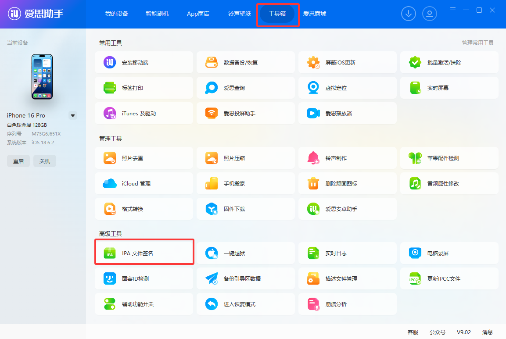
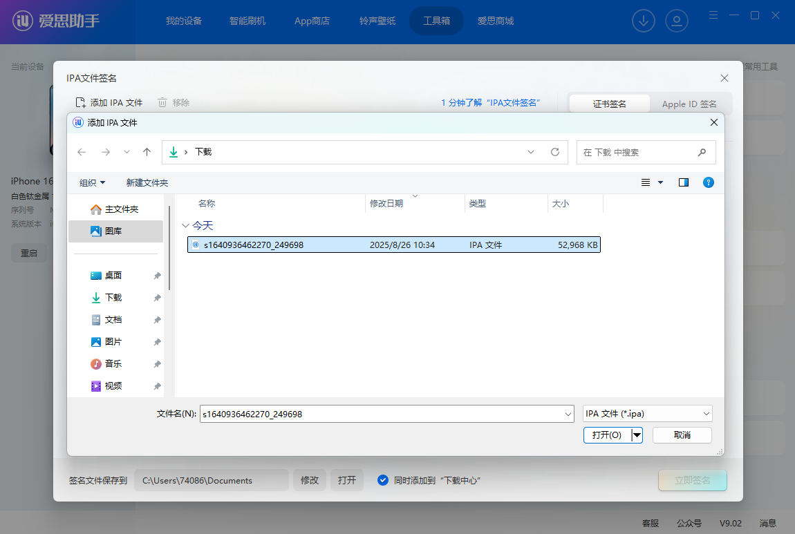
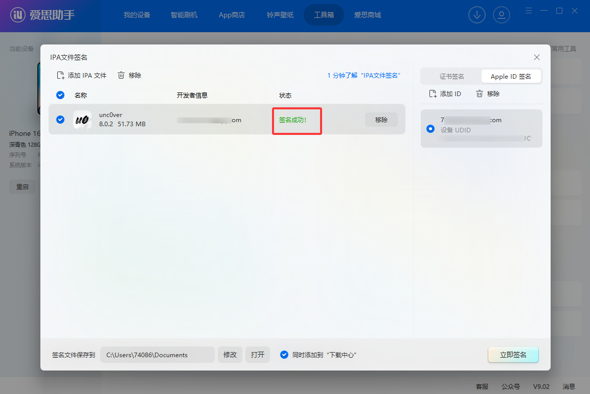
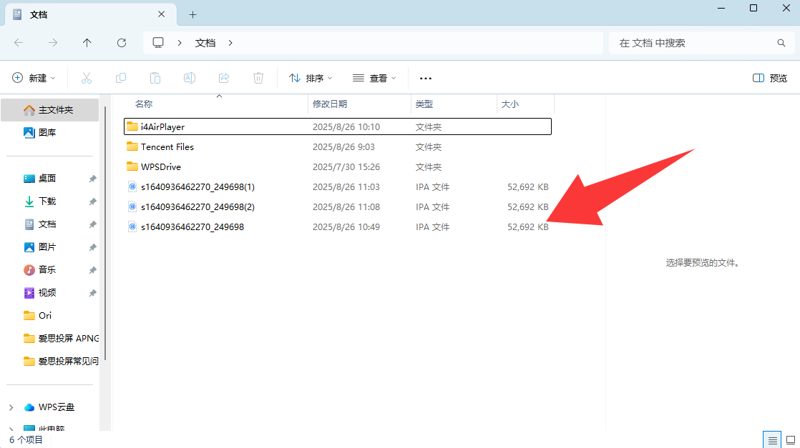

<p align="center">
  
</p>

<h1 align="center">douduo</h1>

界面和播放全部原生（SwiftUI + AVPlayer，VLC 兜底）。

v1.3.15 起新增可选的 iPhone Duo **经典布局**（社区 PR #17），在「更多 → 界面」切换，默认仍是原有布局，保留默认／简洁／极简三档。详见[经典布局与手势说明](docs/classic-duo-layout.md)。经典布局需要 iOS 27.1+，26.x 使用原有布局；仅针对 Duo 适配，未测试 iPad。

官方抖音 App 在折叠屏内屏、iPad 上不适配，网页版又总是跳 App，所以有了它。

## 界面展示

> 以下均为**示意图**（自绘，非实机截图），画面内的视频内容为抽象插画，不含真实用户作品。


### 极简模式：抖音只剩视频

在「更多 → 界面」选择**极简**：页签、作者和标题全部收起；手指按到右侧圆形入口时显示作者标题，松手后消失。



### 进度条藏进入口外圈

简洁 / 极简模式下，视频进度画在圆形入口外圈，不再占用底部进度条；1.3.15 起作者标题整体下移，底部不再留白。



### 可选「经典」布局（1.3.15，感谢 @zenghongjvn PR #17）

系统 Dock、右侧互动胶囊、清屏、双指捏合铺满、长按两侧加速 / 中间设置面板、左滑进作者页。默认不开启，仅 iOS 27.1 及以上显示。



### 上下翻页更利落（1.3.15，感谢 @AppleLiang96 PR #23）

松手后滑到位的动画从约 0.43 秒缩短到约 0.1 秒；长按加速从 0.5 秒改为 0.3 秒，手指一拖就取消长按。



### 动图演示

<p align="center">
  
</p>

## 功能

**看视频**
- 推荐 / 关注 / 直播，顶部一排切换；整页上下滑
- **秒开**：打开 App 先播上次已缓存的视频，连接抖音在后台进行
- **预缓存**：边看边在后台把后面 50 条完整下载到本地，下滑不等加载（菜单可选 关 / 20 / 50 / 100 条，总量超 2GB 自动清理）
- 屏幕任意位置**横滑快进 / 快退**（带预览缩略图），双击点赞，长按 2 倍速，单击暂停
- **自动铺满**：竖屏看竖屏铺满宽度、横屏看横屏铺满高度；方向不一致时保持完整画面（菜单可关）
- 退到后台立即停声

**互动**（需在 App 内登录抖音，见下文）
- 点赞、收藏，同步到你的抖音账号
- 评论：查看、展开楼中楼、**发评论 / 回复**
- **视频弹幕**：显示 + 发送（菜单可关）
- 直播：原生播放（VLC 解 HEVC 流）、**直播间聊天显示 + 发言**
- 保存视频 / 图集到相册

**我的**
- 搜索（联想词、搜索历史）
- 喜欢 / 收藏 / 观看历史 / 稍后再看，点进去接着上下滑
- 作者资料卡

## 下载与签名安装（国内用户）

- **Gitee 国内下载**：[发行版与 IPA 附件](https://gitee.com/remon8/douduo/releases)
- **GitHub 下载**：[最新发行版](https://github.com/81199000/DouDuo/releases/latest)
- GitHub 为主仓库，Gitee 为国内源码与安装包镜像。
- 下载文件名带 `unsigned.ipa` 的安装包；它是**未签名 IPA，不能下载后直接安装**，需要按下方教程自己签名。
- **全能签 / 轻松签软件源**（有证书的用户，添加一次以后在源里一键更新）：国内 `https://gitee.com/remon8/douduo/raw/main/docs/source/douduo.json`，海外 `https://raw.githubusercontent.com/81199000/DouDuo/main/docs/source/douduo-github.json`，用法见[方式二](#方式二全能签--douduo-软件源手机上一键安装和更新)。
- v1.3.15 修复非 Duo 机型默认模式顶栏被推进状态栏点不到（#16）；长按加速改 0.3 秒触发，简洁/极简模式长按时整列淡出，底部留白减少；评论栏按系统竖栏实际宽度收窄（#15）；新增可选「经典」布局（PR #17）、上下翻页更利落（PR #23），最低系统改为 iOS 26.0，详见[更新说明](docs/releases/v1.3.15.md)。
- v1.3.14 修复 1.3.13 滑动卡顿：1x 播放改回系统原生声音（倍速时才启用独立音频引擎），简洁/极简进度环不再带动整屏重算；推荐页半折叠按真实折痕切分视频与评论，详见[更新说明](docs/releases/v1.3.14.md)。
- v1.3.13 新增三档界面模式（默认 / 简洁 / 极简，更多 → 界面）和折叠屏直播分屏与环境光，合入社区 PR #5、#11、#12；倍速改为点开选速度并修复改了不立刻生效；直播评论区与起播提速，详见[更新说明](docs/releases/v1.3.13.md)。
- v1.3.12 关注页与直播页去掉重复的直播头像入口，关注开播统一走「我的关注」；爱思助手签名失败可先在手机上用同一 Apple ID 登录一次 icloud.com 再签，详见[更新说明](docs/releases/v1.3.12.md)。
- v1.3.11 消息中心主从导航、聊天分享视频跳原生播放、评论通知回复与配图、聊天黑色画布与窄屏遮挡修复；右侧图标间距加大并调整展开位置；合入直播恢复与播放门禁（分享浮层暂停、切台恢复），详见[更新说明与待验收项](docs/releases/v1.3.11.md)。
- v1.3.10 倍速控制重做：设置里选播放速度（当前视频立刻生效）、长按下滑锁本条 2 倍速、长按上滑取消、非常速常驻角标；新增后台播放与锁屏控制、直播间选择列表、直播画质选档，详见[更新说明](docs/releases/v1.3.10.md)。
- v1.3.9 把「关注的人正在直播」头像排移到直播页顶部：进入展开、上滑换直播间收成「N 个直播」胶囊，关注页回归纯关注流，详见[更新说明](docs/releases/v1.3.9.md)。
- v1.3.8 新增原生「分享给」浮层（真实好友、官方作品卡片、发送即时回执），朋友与会话改为本地缓存 + 增量同步，弹幕限制在画面上方三分之一，直播分类接入真实分区，右侧栏顺序与间距对齐原版，详见[更新说明](docs/releases/v1.3.8.md)。
- v1.3.7 新增消息中心、陌生人消息分类、评论表情与 @ 用户、评论配图/贴纸及直播发现入口，详见[更新说明](docs/releases/v1.3.7.md)。

## 安装

支持 iOS / iPadOS **26.0 及以上**（iPhone Duo 出厂即 iOS 26）。DouDuo 未在 App Store 上架，需要**自己签名安装**。先按自己的情况选一种：

| | 方式一：爱思助手 | 方式二：全能签 + DouDuo 软件源 |
| --- | --- | --- |
| 花钱吗 | 免费（用自己的 Apple ID） | 要买证书 |
| 要电脑吗 | 每次签名都要连电脑 | 不要，全程在手机上 |
| 有效期 | 7 天，到期重签 | 跟证书走，一般 1 年 |
| 更新新版 | 重新下载、签名、安装 | 软件源里点一下，签名安装 |
| 适合谁 | 有电脑、不想花钱 | 嫌 7 天重签麻烦、想手机上一键更新 |

方式一需要先到 [Gitee 发行版](https://gitee.com/remon8/douduo/releases) 或 [GitHub Releases](https://github.com/81199000/DouDuo/releases/latest) 下载最新的 `DouDuo-x.y.z-unsigned.ipa`（不要下载源码 ZIP 代替 IPA）；方式二直接添加软件源，不用自己下载。

### 方式一：爱思助手（Windows / Mac，免费）

以下配图来自[爱思助手官方 IPA 签名教程](https://www.i4.cn/news_detail_38195.html)；**图中的应用文件名仅为官方示例，实际请选择我们下载的 `DouDuo-1.3.15-unsigned.ipa`**。

#### 1. 连接手机，打开 IPA 签名工具

电脑安装 [爱思助手](https://www.i4.cn)，用数据线连接 iPhone / iPad；解锁设备并点「信任此电脑」，确认电脑能识别设备，再进入 **工具箱 → IPA 签名**。



#### 2. 添加 DouDuo 安装包

点击「添加 IPA 文件」，选择发行版附件中的 `DouDuo-x.y.z-unsigned.ipa`，不要选择源码 ZIP。



#### 3. 使用 Apple ID 签名，选择要安装的设备

选择 **使用 Apple ID 签名 → 添加 Apple ID**，在爱思助手内输入 Apple ID 和密码（建议使用专门的小号），并选择当前连接手机的设备标识。签名与所选设备绑定，不要选成其他手机；如要求验证码，请在签名工具中完成验证。


> **签名失败时：先用同一个 Apple ID 登录一次 iCloud。** 在手机 Safari 打开 [icloud.com](https://www.icloud.com)，用**准备签名的那一个 Apple ID** 登录一次（按提示同意条款、完成双重认证），退出页面后回爱思助手重新点「开始签名」。很多人卡在「签名失败 / 验证失败 / 无法请求签名」，都是因为该 Apple ID 没在设备上登录过 iCloud，登录一次再签通常就能过。

#### 4. 勾选安装包和 Apple ID，开始签名

勾选 DouDuo IPA 与对应 Apple ID，点击「开始签名」，等待状态显示「签名成功」。



#### 5. 打开签名目录，手动安装已签名 IPA

**签名完成不等于已经安装。** 点击「签名文件保存到」旁边的「打开」，找到新生成的已签名 IPA；它与刚下载的未签名原包可能不在同一个目录。


在打开的目录中找到已签名 IPA，双击交给爱思助手安装，或从爱思助手的应用管理中导入安装；**不要拿未签名原包直接安装**。



#### 6. 在手机上信任开发者并打开应用

手机打开 **设置 → 通用 → VPN 与设备管理**，找到签名使用的 Apple ID / 开发者条目，点「信任」。如系统要求，再打开 **设置 → 隐私与安全性 → 开发者模式**，按提示重启并确认启用，随后打开 DouDuo。

> **7 天到期怎么办？** 免费 Apple ID 签名通常 **7 天后过期**，届时可能打不开；重复以上签名流程并覆盖安装。尽量使用同一 Apple ID、保持相同应用标识，**不要先卸载旧 App**，以免丢失本地数据。
>
> **常见问题**：安装失败先检查设备是否选对、手机是否解锁并信任电脑，以及是否使用签名后的 IPA；不受信任或开发者模式提示按第 6 步处理。不同版本爱思助手的按钮名称和位置可能略有不同。

### 方式二：全能签 + DouDuo 软件源（手机上一键安装和更新）

[全能签](https://sign.drnrt8.cn/sign/)是手机上的签名工具：导入证书后，在 App 里就能下载、签名、安装，**不用电脑**。DouDuo 提供官方软件源，添加一次，以后有新版在源里直接点更新。

> **先说清楚：全能签本身免费，但必须有证书才能用。** 顺序是「先有证书 → 再装全能签」，不需要先用爱思助手装全能签（用免费 Apple ID 装的全能签 7 天就失效，里面也没有能用的证书）。

#### 1. 买证书（二选一）

| | 全能签官网买兑换码（推荐新手） | 淘宝 / 闲鱼买证书 |
| --- | --- | --- |
| 价格 | 稍贵 | 便宜一些 |
| 拿到什么 | 兑换码，输入后证书和全能签一起自动装好 | `.p12` 证书 + `.mobileprovision` 描述文件 + 证书密码 |
| 麻烦程度 | 一步到位 | 要自己上传证书装全能签，再把证书导入全能签 |
| 售后 | 官网客服 | 看卖家，掉签补不补要先问清楚 |

买之前都要先拿到手机的 **UDID**（设备号），证书是绑定这台手机的：用 **Safari** 打开 [全能签官网](https://sign.drnrt8.cn/sign/) 点「获取 UDID」，按提示安装描述文件即可看到。


*（图片来自[全能签官网](https://sign.drnrt8.cn/sign/)安装页教程）*

#### 2. 安装全能签

- **官网兑换码**：在 [全能签官网](https://sign.drnrt8.cn/sign/) 输入兑换码 →「立即安装」，回到桌面等全能签装好。
- **淘宝 / 闲鱼证书**：在 [全能签官网](https://sign.drnrt8.cn/sign/) 点「我有证书 ｜ 自助安装」，上传 `.p12` 和 `.mobileprovision`，填证书密码 →「签名安装」。

装好后打开 **设置 → 通用 → VPN 与设备管理** 信任证书；iOS 16 及以上还要打开 **设置 → 隐私与安全性 → 开发者模式**，按提示重启，开机后点「启用」。


*（图片来自[全能签官网](https://sign.drnrt8.cn/sign/)安装页教程）*

#### 3. 把证书导入全能签

打开全能签 → 底部 **设置 → 导入文件**，选 `.p12` 和 `.mobileprovision`（或卖家给的证书 zip 包），输入证书密码。回到 **证书** 页，看到证书状态有效就可以了。官网兑换码通常会提供证书包下载，同样按这一步导入。

#### 4. 添加 DouDuo 软件源

全能签 → **资源 → 软件源** → 右上角添加，粘贴下面任一地址：

| 软件源 | 地址 |
| --- | --- |
| 国内（推荐，Gitee 下载快） | `https://gitee.com/remon8/douduo/raw/main/docs/source/douduo.json` |
| 海外（GitHub） | `https://raw.githubusercontent.com/81199000/DouDuo/main/docs/source/douduo-github.json` |

源里保留最近几个版本，新版在最上面，每个版本附更新说明。

#### 5. 签名并安装 DouDuo

在软件源里点 DouDuo → 下载 → 到 **资源 → App** 里点它 → **签名**（选刚导入的证书）→ 签好后点 **安装**。第一次打开如提示不受信任，按第 2 步信任证书。

**以后更新**：在软件源里下拉刷新，看到新版本点下载 → 签名 → 安装，会直接覆盖旧版，登录状态保留。

> ⚠️ **证书风险**：买来的证书可能被苹果吊销（俗称「掉签」），掉签后用它签的 App 都打不开，只能换证书重签。所以买之前问清楚掉签是否补发。不要使用网上流传的「免费证书」「共享证书」，掉签更频繁，也有隐私风险。轻松签等同类工具用法类似，同样可以添加上面的软件源。

### 其他方式

- **[Sideloadly](https://sideloadly.io)（Windows / Mac）**：和爱思助手一样用免费 Apple ID 签名，7 天有效。连上 iPhone，把 IPA 拖进窗口，填 Apple ID 后点「Start」；Windows 需要先装 iTunes 和 iCloud 的**官网桌面版**。开启「Automatic refresh」后，电脑开着、手机在同一 Wi‑Fi 时会自动续签。
- **[SideStore](https://sidestore.io) / [AltStore](https://altstore.io)**：同样用免费 Apple ID，可以自动续签。SideStore 首次配置后不用再连电脑；AltStore 需要电脑常驻 AltServer。
- **TrollStore（巨魔）**：签一次永久有效，但只支持部分系统版本（以 TrollStore 官方说明为准），较新的 iOS 用不了。

### 自己编译（有 Mac）

需要 macOS + Xcode 26 以上、[XcodeGen](https://github.com/yonaskolb/XcodeGen)。

```bash
git clone https://github.com/81199000/DouDuo.git
cd DouDuo
brew install xcodegen
./scripts/fetch-vlckit.sh      # 下载 VLC 播放内核（约 1GB，不在仓库里）
xcodegen generate
open DouDuo.xcodeproj
```

在 Xcode 里：
1. 选中 `DouDuo` target →「Signing & Capabilities」→ Team 选你自己的 Apple ID（Xcode → Settings → Accounts 先登录）
2. 把 Bundle Identifier 改成你自己的（比如 `com.yourname.douduo`），免费账号不能用别人注册过的 ID
3. 连上 iPhone，选中设备，点 ▶︎ 运行
4. 手机上信任开发者 + 按系统提示打开开发者模式（同方式一的第 6 步）

免费账号同样 7 天有效；付费开发者账号（99 美元 / 年）签的一年有效。

只想要未签名 IPA：`./release.sh`（产物在 `build/`，有 `gh` 登录时会顺带上传 Release）。

## 首次使用：登录抖音

点右上角「我的」→「网页版 / 登录」，在抖音网页里用**验证码或密码**登录。登录后：

- 推荐流会按你的账号个性化
- 点赞、收藏、评论、弹幕会同步到你的抖音账号
- 「我的」里能看到喜欢、收藏、观看历史

不登录也能看推荐、搜索、直播。登录信息只保存在手机本地，不经过任何第三方服务器。

## 常见问题

- **打开就闪退**：签名过期了（免费 Apple ID 7 天），重新签名安装即可；用全能签的，先看证书页证书是否还有效，失效（掉签）就要换证书重签。
- **提示「抖音拦截了请求」/ 一直加载**：点菜单 →「网页版 / 登录」，在网页里刷一下（必要时过一下滑块验证），返回后会自动重试。
- **视频黑屏或卡住**：App 会自动重试，并切换到 VLC 内核兜底；仍不行就下滑到下一条。
- **占用空间大**：菜单 →「预缓存视频」调小或关闭，或者点「清除视频缓存」。用流量刷时建议关掉预缓存。
- **搜索结果只有一页**：抖音网页接口只返回第一页，目前没有办法翻页。

## 原理

没有逆向抖音 App，也不需要任何密钥：

- App 里挂着一个**看不见的抖音网页**（电脑版 UA）。所有接口请求都在这个页面里发出，由抖音网页自己的安全 SDK 自动补签名（`a_bogus` 等），所以签名算法跟着官方更新走。
- 视频地址用接口返回的 `/aweme/v1/play/`（302 到 CDN mp4）。CDN 要求带浏览器 UA + Referer，否则部分节点 403。
- 普通视频用 `AVPlayer`；起不来时自动切 VLC。直播流是 HEVC + MPEG‑TS，AVPlayer 只能出声音，所以直播一律用 VLC。
- 直播间聊天：后台打开一个隐藏的直播间网页，读它渲染出来的聊天列表，不碰 WebSocket 协议。
- 登录态和「网页版」共用 `WKWebsiteDataStore.default()`，只存在本机。

主要接口：

| 功能 | 接口 |
| --- | --- |
| 推荐 | `POST /aweme/v2/web/module/feed/` |
| 关注 | `/aweme/v1/web/follow/feed/` |
| 搜索 / 联想 | `/aweme/v1/web/search/item/`、`/search/sug/` |
| 评论 / 楼中楼 / 发评论 | `/comment/list/`、`/aweme/v2/web/comment/list/reply/`、`POST /comment/publish` |
| 弹幕 / 发弹幕 | `/danmaku/get_v2/`、`POST /danmaku/post_v2/` |
| 点赞 / 收藏 | `POST /commit/item/digg/`、`POST /commit/item/collect/` |
| 喜欢 / 收藏 / 历史 / 稍后再看 | `/aweme/favorite/`、`POST /aweme/listcollection/`、`/history/read/`、`/watchlater/list/` |
| 直播 | `live.douyin.com/webcast/feed/` |

## 项目结构

```
DouDuo/
  DouDuoApp.swift          入口、退后台停声
  DouyinFeedView.swift     推荐 / 直播主界面、签名代理（DouyinBridge）、评论
  DouyinExtras.swift       搜索、我的、关注、作者页、弹幕、保存、发评论 / 弹幕
  DouyinLiveChat.swift     直播间聊天（显示 + 发言）
  DouyinVideoCache.swift   本地视频预缓存 + 秒开
  ShortVideoPlayer.swift   播放器（手势、进度、VLC 兜底、弹幕层）
  VLCPlayerBridge.swift    VLC 封装
  DouyinWebView.swift      网页版容器（登录）
Vendor/VLCKit/             VLC 本地 Swift Package（二进制用脚本下载）
project.yml                XcodeGen 工程定义
```

## 已知限制

- 搜索只有第一页；作者的作品列表要点「查看全部作品」去网页版看（网页接口签名受限）
- 抖音风控时可能要去「网页版」过一下验证
- 抖音网页接口改版时，需要跟着更新

欢迎提 Issue / PR。

## 免责声明

> 本声明说明项目意图与边界，**不构成法律意见，也不能免除法律责任**；它不能替代权利人的授权。

- **非官方、无授权**：本项目是个人学习与技术研究用的第三方客户端，与抖音、北京微播视界科技有限公司及其关联公司**没有任何隶属、合作或授权关系**。「抖音」等名称、商标、图标归其权利人所有，本项目仅作描述性提及，不把官方标识当作自己的品牌，也不代表官方立场。
- **不提供、不存储、不分发内容**：App 只在你自己的设备上展示通过抖音网页接口获取的内容，不搭建内容服务、不缓存分发、不提供下载。视频、图片、音乐、评论、直播流的版权归原作者与平台所有。
- **账号与使用责任**：使用本项目需要你自己的抖音账号登录。请自行遵守《抖音用户服务协议》和所在地法律；**禁止**用于商业用途、批量抓取、刷量、绕过付费或权限、二次分发，以及其他侵害他人权益的行为。账号被限制、数据丢失、设备异常等后果由使用者自行承担。
- **不绕过付费与权限**：本项目不提供会员内容、付费内容、私密内容的解锁能力，也不修改平台返回的权限结果。
- **签名与分发**：仓库和软件源只提供**未签名 IPA**，签名由使用者自行完成（自己的 Apple ID，免费账号通常 7 天有效；或自行购买的签名证书）。本项目**不出售、不提供任何证书**，与全能签及各证书卖家无合作关系；证书来源、掉签等风险由使用者自行判断。请勿分发已签名安装包。
- **无担保**：软件按「现状」提供，不保证可用性、稳定性、合规性或适用于特定目的；平台接口改版或风控可能导致功能随时失效。
- **侵权处理**：如权利人认为本项目侵犯其权益，请通过 Issue 或仓库公开的联系方式告知，核实后会删除相关内容或停止分发。
- **地区差异**：不同国家和地区对第三方客户端、逆向与接口调用的规定不同；如当地法律禁止，请不要使用或分发本项目。

## License

[MIT](LICENSE)
