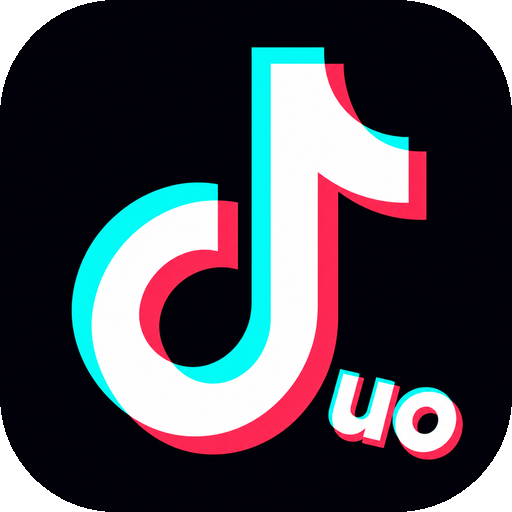
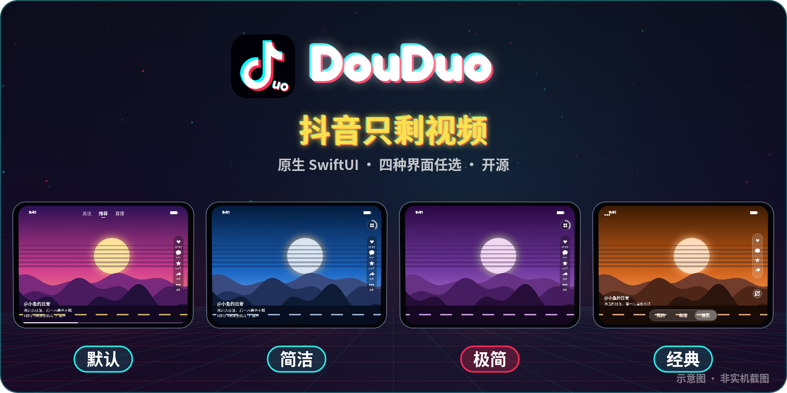
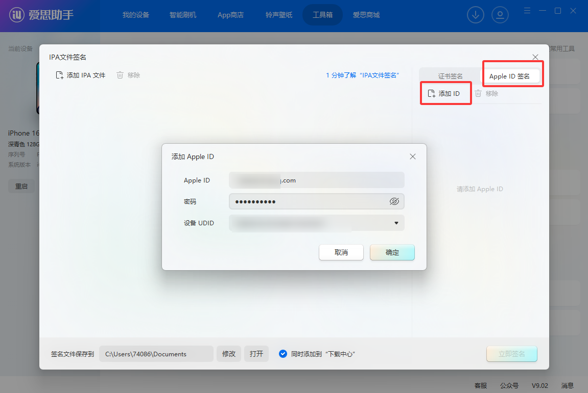
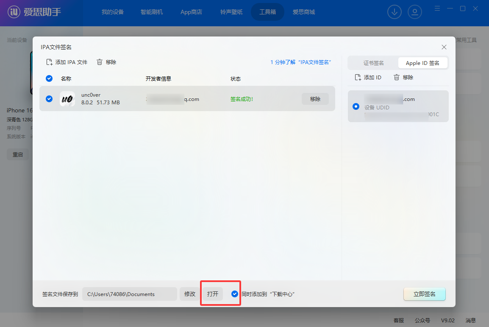
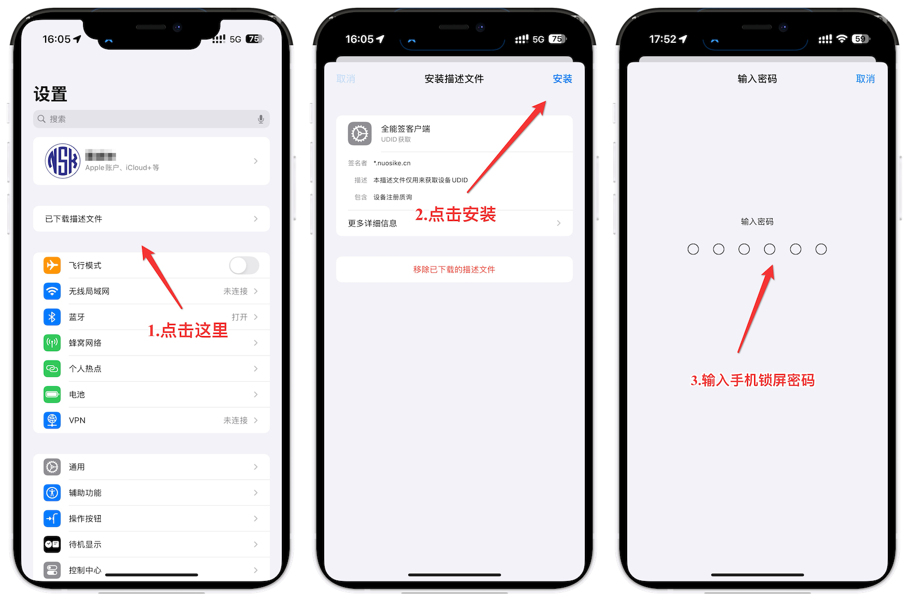
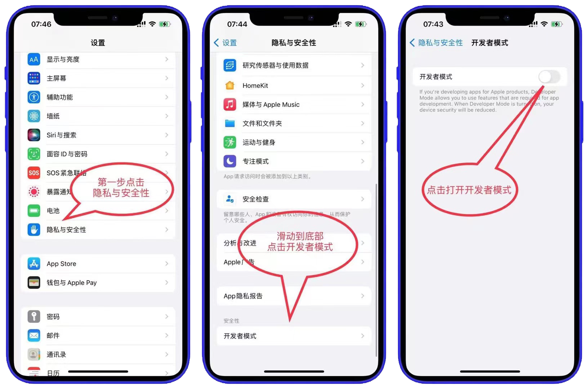

<p align="center">
  
</p>

<h1 align="center">douduo</h1>

<p align="center">原生 SwiftUI 的第三方抖音客户端，适配 iPhone Duo 折叠屏、iPad 与普通 iPhone。开源免费，非官方。</p>

官方抖音 App 在折叠屏内屏、iPad 上不适配，网页版又总是跳 App，所以有了它。界面和播放全部原生（SwiftUI + AVPlayer，VLC 兜底）。



<sub>示意图（自绘，非实机截图），画面内容为抽象插画，不含真实用户作品。</sub>

## 功能

**看视频**
- 推荐 / 关注 / 直播，整页上下滑；**秒开**（先播上次缓存的视频）+ 后台**预缓存**后面若干条
- 四种界面，「更多 → 设置 → 界面模式」切换：**默认 / 简洁 / 极简**（极简只剩视频，进度画在右侧圆形入口外圈），以及 iPhone Duo 可选的**经典**布局（iOS 27.1+，[说明](docs/classic-duo-layout.md)）
- 横滑快进快退（带预览）、双击点赞、长按加速、倍速选档、自动连播、后台播放与锁屏控制
- 实时环境光：视频没铺满时四周跟随画面颜色，黑底，亮 / 中 / 暗 / 很暗 / 关五档
- 折叠屏：半折叠按折痕分屏（视频 / 评论）、横屏搜索左右分栏；自动铺满可关
- `#话题` 点击直接搜索；推荐页可按标签屏蔽不想看的内容

**互动**（需在 App 内登录抖音）
- 点赞、收藏、评论 / 回复（表情、@ 用户、配图）、弹幕显示与发送
- 消息中心与私信、原生「分享给」好友
- 直播：原生播放（VLC 解 HEVC）、直播间聊天与发言、关注主播开播条、画质选档

**我的**
- 搜索（联想词、热搜、历史）、喜欢 / 收藏 / 观看历史 / 稍后再看、作者主页与作品列表
- 保存视频 / 图集到相册

每个版本的改动见 [更新说明](docs/releases/)（最新：[v1.5.1](docs/releases/v1.5.1.md)）。

<a id="下载与签名安装国内用户"></a>

## 下载与签名安装

支持 iOS / iPadOS **26.0 及以上**。DouDuo 未上架 App Store，安装包是**未签名 IPA**（文件名带 `unsigned.ipa`），不能直接安装，需要自己签名。

- **下载**：[Gitee 发行版](https://gitee.com/remon8/douduo/releases)（国内快）· [GitHub Releases](https://github.com/81199000/DouDuo/releases/latest)；不要下载源码 ZIP 代替 IPA
- **全能签 / 轻松签软件源**：国内 `https://gitee.com/remon8/douduo/raw/main/docs/source/douduo.json`，海外 `https://raw.githubusercontent.com/81199000/DouDuo/main/docs/source/douduo-github.json`

两种主要方式，按自己情况选：

| | 方式一：爱思助手 | 方式二：全能签 + DouDuo 软件源 |
| --- | --- | --- |
| 花钱吗 | 免费（用自己的 Apple ID） | 要买证书 |
| 要电脑吗 | 每次签名都要连电脑 | 不要，全程在手机上 |
| 有效期 | 7 天，到期重签 | 跟证书走，一般 1 年 |
| 更新新版 | 重新下载、签名、安装 | 软件源里点一下，签名安装 |
| 适合谁 | 有电脑、不想花钱 | 嫌 7 天重签麻烦、想手机上一键更新 |

### 方式一：爱思助手（Windows / Mac，免费）

以下配图来自[爱思助手官方 IPA 签名教程](https://www.i4.cn/news_detail_38195.html)；**图中的应用文件名仅为官方示例，实际请选择下载的 `DouDuo-x.y.z-unsigned.ipa`**。

#### 1. 连接手机，打开 IPA 签名工具

电脑安装 [爱思助手](https://www.i4.cn)，用数据线连接 iPhone / iPad；解锁设备并点「信任此电脑」，确认电脑能识别设备，再进入 **工具箱 → IPA 签名**。


#### 2. 添加 DouDuo 安装包

点击「添加 IPA 文件」，选择发行版附件中的 `DouDuo-x.y.z-unsigned.ipa`，不要选择源码 ZIP。


#### 3. 使用 Apple ID 签名，选择要安装的设备

选择 **使用 Apple ID 签名 → 添加 Apple ID**，在爱思助手内输入 Apple ID 和密码（建议使用专门的小号），并选择当前连接手机的设备标识。签名与所选设备绑定，不要选成其他手机；如要求验证码，请在签名工具中完成验证。



> **签名失败时：先用同一个 Apple ID 登录一次 iCloud。** 在手机 Safari 打开 [icloud.com](https://www.icloud.com)，用**准备签名的那一个 Apple ID** 登录一次（按提示同意条款、完成双重认证），退出页面后回爱思助手重新点「开始签名」。很多人卡在「签名失败 / 验证失败 / 无法请求签名」，都是因为该 Apple ID 没在设备上登录过 iCloud，登录一次再签通常就能过。

#### 4. 勾选安装包和 Apple ID，开始签名

勾选 DouDuo IPA 与对应 Apple ID，点击「开始签名」，等待状态显示「签名成功」。


#### 5. 打开签名目录，手动安装已签名 IPA

**签名完成不等于已经安装。** 点击「签名文件保存到」旁边的「打开」，找到新生成的已签名 IPA（它与未签名原包可能不在同一个目录），双击交给爱思助手安装，或从爱思助手的应用管理中导入安装；**不要拿未签名原包直接安装**。



#### 6. 在手机上信任开发者并打开应用

手机打开 **设置 → 通用 → VPN 与设备管理**，找到签名使用的 Apple ID / 开发者条目，点「信任」。如系统要求，再打开 **设置 → 隐私与安全性 → 开发者模式**，按提示重启并确认启用，随后打开 DouDuo。

> **7 天到期怎么办？** 免费 Apple ID 签名通常 **7 天后过期**，届时可能打不开；重复以上签名流程并覆盖安装。尽量使用同一 Apple ID，**不要先卸载旧 App**，以免丢失本地数据。安装失败先检查设备是否选对、手机是否解锁并信任电脑，以及是否使用签名后的 IPA。

### 方式二：全能签 + DouDuo 软件源（手机上一键安装和更新）

[全能签](https://sign.drnrt8.cn/sign/)是手机上的签名工具：导入证书后，在 App 里就能下载、签名、安装，**不用电脑**。DouDuo 提供官方软件源，添加一次，以后有新版在源里直接点更新。

> **先说清楚：全能签本身免费，但必须有证书才能用。** 顺序是「先有证书 → 再装全能签」，不需要先用爱思助手装全能签（用免费 Apple ID 装的全能签 7 天就失效，里面也没有能用的证书）。

#### 1. 买证书（二选一）

| | 全能签官网买兑换码（推荐新手） | 淘宝 / 闲鱼买证书 |
| --- | --- | --- |
| 价格 | 稍贵 | 便宜一些 |
| 拿到什么 | 兑换码，输入后证书和全能签一起自动装好 | `.p12` 证书 + `.mobileprovision` 描述文件 + 证书密码 |
| 麻烦程度 | 一步到位 | 要自己上传证书装全能签，再把证书导入全能签 |
| 售后 | 官网客服 | 看卖家，掉签补不补要先问清楚 |

买之前都要先拿到手机的 **UDID**（设备号），证书是绑定这台手机的：用 **Safari** 打开 [全能签官网](https://sign.drnrt8.cn/sign/) 点「获取 UDID」，按提示安装描述文件即可看到。



<sub>图片来自[全能签官网](https://sign.drnrt8.cn/sign/)安装页教程。</sub>

#### 2. 安装全能签

- **官网兑换码**：在 [全能签官网](https://sign.drnrt8.cn/sign/) 输入兑换码 →「立即安装」，回到桌面等全能签装好。
- **淘宝 / 闲鱼证书**：在 [全能签官网](https://sign.drnrt8.cn/sign/) 点「我有证书 ｜ 自助安装」，上传 `.p12` 和 `.mobileprovision`，填证书密码 →「签名安装」。

装好后打开 **设置 → 通用 → VPN 与设备管理** 信任证书；iOS 16 及以上还要打开 **设置 → 隐私与安全性 → 开发者模式**，按提示重启，开机后点「启用」。



<sub>图片来自[全能签官网](https://sign.drnrt8.cn/sign/)安装页教程。</sub>

#### 3. 把证书导入全能签

打开全能签 → 底部 **设置 → 导入文件**，选 `.p12` 和 `.mobileprovision`（或卖家给的证书 zip 包），输入证书密码。回到 **证书** 页，看到证书状态有效就可以了。官网兑换码通常会提供证书包下载，同样按这一步导入。

#### 4. 添加 DouDuo 软件源

全能签 → **资源 → 软件源** → 右上角添加，粘贴下面任一地址：

| 软件源 | 地址 |
| --- | --- |
| 国内（推荐，Gitee 下载快） | `https://gitee.com/remon8/douduo/raw/main/docs/source/douduo.json` |
| 海外（GitHub） | `https://raw.githubusercontent.com/81199000/DouDuo/main/docs/source/douduo-github.json` |

源里保留最近几个版本，新版在最上面，每个版本附更新说明。

#### 5. 签名并安装 DouDuo

在软件源里点 DouDuo → 下载 → 到 **资源 → App** 里点它 → **签名**（选刚导入的证书）→ 签好后点 **安装**。第一次打开如提示不受信任，按第 2 步信任证书。

**以后更新**：在软件源里下拉刷新，看到新版本点下载 → 签名 → 安装，会直接覆盖旧版，登录状态保留。

> ⚠️ **证书风险**：买来的证书可能被苹果吊销（俗称「掉签」），掉签后用它签的 App 都打不开，只能换证书重签。所以买之前问清楚掉签是否补发。不要使用网上流传的「免费证书」「共享证书」，掉签更频繁，也有隐私风险。轻松签等同类工具用法类似，同样可以添加上面的软件源。

### 其他方式

- **[Sideloadly](https://sideloadly.io)（Windows / Mac）**：和爱思助手一样用免费 Apple ID 签名，7 天有效。连上 iPhone，把 IPA 拖进窗口，填 Apple ID 后点「Start」；Windows 需要先装 iTunes 和 iCloud 的**官网桌面版**。开启「Automatic refresh」后，电脑开着、手机在同一 Wi‑Fi 时会自动续签。
- **[SideStore](https://sidestore.io) / [AltStore](https://altstore.io)**：同样用免费 Apple ID，可以自动续签。SideStore 首次配置后不用再连电脑；AltStore 需要电脑常驻 AltServer。
- **TrollStore（巨魔）**：签一次永久有效，但只支持部分系统版本（以 TrollStore 官方说明为准），较新的 iOS 用不了。
- **自己编译（有 Mac）**：需要 Xcode 26 以上和 [XcodeGen](https://github.com/yonaskolb/XcodeGen)。

  ```bash
  git clone https://github.com/81199000/DouDuo.git && cd DouDuo
  brew install xcodegen
  ./scripts/fetch-vlckit.sh      # 下载 VLC 播放内核（约 1GB，不在仓库里）
  xcodegen generate && open DouDuo.xcodeproj
  ```

  在 Xcode 里 Team 选自己的 Apple ID，Bundle Identifier 改成自己的（如 `com.yourname.douduo`），连上 iPhone 点 ▶︎ 运行，再按方式一第 6 步信任开发者。

## 首次使用：登录抖音

点右上角「我的」→「网页版 / 登录」，在抖音网页里用**验证码或密码**登录。登录后推荐流按你的账号个性化，点赞、收藏、评论、弹幕会同步到你的抖音账号。

不登录也能看推荐、搜索、直播。登录信息只保存在手机本地，不经过任何第三方服务器。

## 常见问题

- **打开就闪退**：签名过期了（免费 Apple ID 7 天），重新签名安装即可；用全能签的，先看证书页证书是否还有效，失效（掉签）就要换证书重签。
- **提示「抖音拦截了请求」/ 一直加载**：点菜单 →「网页版 / 登录」，在网页里刷一下（必要时过一下滑块验证），返回后会自动重试。
- **视频黑屏或卡住**：App 会自动重试，并切换到 VLC 内核兜底；仍不行就下滑到下一条。
- **占用空间大**：「更多 → 设置 → 缓存」把预缓存数量调小或关闭，或者点「清除视频缓存」。用流量刷时建议关掉预缓存。

## 已知限制

- **搜索只有第一页**：抖音网页接口翻第二页会被安全 SDK 拦下，目前没有办法翻页。
- **图文作品偶尔没有背景音乐**（[#19](https://github.com/81199000/DouDuo/issues/19)）。
- **经典布局**只在 iOS 27.1 及以上显示，仅针对 iPhone Duo 适配；iPad、画中画尚未完整实测。
- 抖音风控时可能要去「网页版」过一下验证；抖音网页接口改版时需要跟着更新。

欢迎提 [Issue](https://github.com/81199000/DouDuo/issues) / PR。

## 原理

没有逆向抖音 App，也不需要任何密钥：App 里挂着一个**看不见的抖音网页**（电脑版 UA），所有接口请求都在这个页面里发出，由抖音网页自己的安全 SDK 自动补签名（`a_bogus` 等），所以签名算法跟着官方更新走。普通视频用 `AVPlayer`，起不来时自动切 VLC；直播流是 HEVC + MPEG‑TS，一律用 VLC。登录态和「网页版」共用 `WKWebsiteDataStore.default()`，只存在本机。

已接入的接口清单见 [docs/api-inventory.md](docs/api-inventory.md)；维护者发版流程见 [docs/RELEASING.md](docs/RELEASING.md)。

## 免责声明

> 本声明说明项目意图与边界，**不构成法律意见，也不能免除法律责任**；它不能替代权利人的授权。

- **非官方、无授权**：本项目是个人学习与技术研究用的第三方客户端，与抖音、北京微播视界科技有限公司及其关联公司**没有任何隶属、合作或授权关系**。「抖音」等名称、商标、图标归其权利人所有，本项目仅作描述性提及，不把官方标识当作自己的品牌，也不代表官方立场。
- **不提供、不存储、不分发内容**：App 只在你自己的设备上展示通过抖音网页接口获取的内容，不搭建内容服务、不缓存分发、不提供下载。视频、图片、音乐、评论、直播流的版权归原作者与平台所有。
- **账号与使用责任**：使用本项目需要你自己的抖音账号登录。请自行遵守《抖音用户服务协议》和所在地法律；**禁止**用于商业用途、批量抓取、刷量、绕过付费或权限、二次分发，以及其他侵害他人权益的行为。账号被限制、数据丢失、设备异常等后果由使用者自行承担。
- **不绕过付费与权限**：本项目不提供会员内容、付费内容、私密内容的解锁能力，也不修改平台返回的权限结果。
- **签名与分发**：仓库和软件源只提供**未签名 IPA**，签名由使用者自行完成（自己的 Apple ID，免费账号通常 7 天有效；或自行购买的签名证书）。本项目**不出售、不提供任何证书**，与全能签及各证书卖家无合作关系；证书来源、掉签等风险由使用者自行判断。请勿分发已签名安装包。
- **无担保**：软件按「现状」提供，不保证可用性、稳定性、合规性或适用于特定目的；平台接口改版或风控可能导致功能随时失效。
- **侵权处理**：如权利人认为本项目侵犯其权益，请通过 Issue 或仓库公开的联系方式告知，核实后会删除相关内容或停止分发。
- **地区差异**：不同国家和地区对第三方客户端、逆向与接口调用的规定不同；如当地法律禁止，请不要使用或分发本项目。

## License

[MIT](LICENSE)
