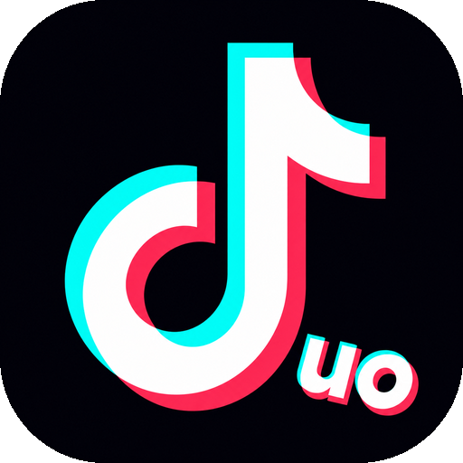
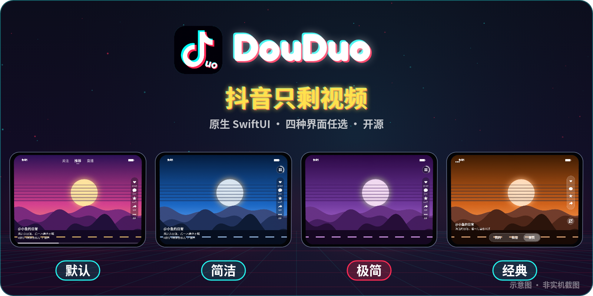

  

<h1 align="center">douduo</h1>

原生 SwiftUI 的第三方抖音客户端，适配 iPhone Duo 折叠屏、iPad 与普通 iPhone。开源免费，非官方。

官方抖音 App 在折叠屏内屏、iPad 上不适配，网页版又总是跳 App，所以有了它。界面和播放全部原生（SwiftUI + AVPlayer，VLC 兜底）。

示意图（自绘，非实机截图），画面内容为抽象插画，不含真实用户作品。

## 功能

**看视频**
- 推荐 / 关注 / 直播，整页上下滑；**秒开**（先播上次缓存的视频）+ 后台**预缓存**后面若干条
- 四种界面，「更多 → 设置 → 界面模式」切换：**默认 / 简洁 / 极简**（极简只剩视频，进度画在右侧圆形入口外圈），以及 iPhone Duo 可选的**经典**布局（iOS 27.1+，[说明](docs/classic-duo-layout.md)）。四种界面共用同一套交互，维护规矩见 [docs/ui-modes.md](docs/ui-modes.md)
- 横滑快进快退（带预览）、双击点赞、长按加速、倍速选档、自动连播、后台播放与锁屏控制
- 实时环境光：视频没铺满时四周跟随画面颜色，黑底，亮 / 中 / 暗 / 很暗 / 关五档
- 折叠屏：半折叠按折痕分屏（视频 / 评论）、横屏搜索左右分栏；自动铺满可关
- `#话题` 点击直接搜索；推荐页可按标签屏蔽不想看的内容

**互动**（需在 App 内登录抖音）
- 点赞、收藏、评论 / 回复（表情、@ 用户、配图）、弹幕显示与发送
- 消息中心与私信、原生「分享给」好友
- 直播：原生播放（VLC 解 HEVC）、直播间聊天与发言、关注主播开播条、画质选档

**我的**
- 搜索（联想词、热搜、历史）、喜欢 / 收藏 / 观看历史 / 稍后再看、作者主页与作品列表
- 保存视频 / 图集到相册

每个版本的改动见 [更新说明](docs/releases/) 或 [GitHub Releases](https://github.com/81199000/DouDuo/releases)。

## 下载安装

DouDuo 未上架 App Store，用 **[一键签](https://github.com/81199000/OneDuo)** 安装：免费，用自己的 Apple ID，到期自动续签。

1. 下载 [一键签](https://github.com/81199000/OneDuo/releases/latest)（Windows / Mac）
2. 数据线连手机，在一键签里选 **DouDuo**，点 **一键安装**
3. 手机上 **设置 → 通用 → VPN 与设备管理** 信任你的 Apple ID

详细步骤见 [一键签使用教程](https://github.com/81199000/OneDuo#使用教程)。

> 更新也在一键签里完成：有新版会自动装上，登录状态和观看记录会保留。

## 首次使用：登录抖音

点右上角「我的」→「网页版 / 登录」，在抖音网页里用**验证码或密码**登录。登录后推荐流按你的账号个性化，点赞、收藏、评论、弹幕会同步到你的抖音账号。

不登录也能看推荐、搜索、直播。登录信息只保存在手机本地，不经过任何第三方服务器。

## 常见问题

- **打开就闪退**：签名过期了（免费 Apple ID 7 天），打开一键签点「立即全部续签」。
- **提示「抖音拦截了请求」/ 一直加载**：点菜单 →「网页版 / 登录」，在网页里刷一下（必要时过一下滑块验证），返回后会自动重试。
- **视频黑屏或卡住**：App 会自动重试，并切换到 VLC 内核兜底；仍不行就下滑到下一条。
- **占用空间大**：「更多 → 设置 → 缓存」把预缓存数量调小或关闭，或者点「清除视频缓存」。用流量刷时建议关掉预缓存。

## 已知限制

- **搜索只有第一页**：抖音网页接口翻第二页会被安全 SDK 拦下，目前没有办法翻页。
- **图文作品偶尔没有背景音乐**（[#19](https://github.com/81199000/DouDuo/issues/19)）。
- **经典布局**只在 iOS 27.1 及以上显示，仅针对 iPhone Duo 适配；iPad、画中画尚未完整实测。
- 抖音风控时可能要去「网页版」过一下验证；抖音网页接口改版时需要跟着更新。

欢迎提 [Issue](https://github.com/81199000/DouDuo/issues) / PR。

## 原理

没有逆向抖音 App，也不需要任何密钥：App 里挂着一个**看不见的抖音网页**（电脑版 UA），所有接口请求都在这个页面里发出，由抖音网页自己的安全 SDK 自动补签名（`a_bogus` 等），所以签名算法跟着官方更新走。普通视频用 `AVPlayer`，起不来时自动切 VLC；直播流是 HEVC + MPEG‑TS，一律用 VLC。登录态和「网页版」共用 `WKWebsiteDataStore.default()`，只存在本机。

已接入的接口清单见 [docs/api-inventory.md](docs/api-inventory.md)；维护者发版流程见 [docs/RELEASING.md](docs/RELEASING.md)。

## 免责声明

> 本声明说明项目意图与边界，**不构成法律意见，也不能免除法律责任**；它不能替代权利人的授权。

- **非官方、无授权**：本项目是个人学习与技术研究用的第三方客户端，与抖音、北京微播视界科技有限公司及其关联公司**没有任何隶属、合作或授权关系**。「抖音」等名称、商标、图标归其权利人所有，本项目仅作描述性提及，不把官方标识当作自己的品牌，也不代表官方立场。
- **不提供、不存储、不分发内容**：App 只在你自己的设备上展示通过抖音网页接口获取的内容，不搭建内容服务、不缓存分发、不提供下载。视频、图片、音乐、评论、直播流的版权归原作者与平台所有。
- **账号与使用责任**：使用本项目需要你自己的抖音账号登录。请自行遵守《抖音用户服务协议》和所在地法律；**禁止**用于商业用途、批量抓取、刷量、绕过付费或权限、二次分发，以及其他侵害他人权益的行为。账号被限制、数据丢失、设备异常等后果由使用者自行承担。
- **不绕过付费与权限**：本项目不提供会员内容、付费内容、私密内容的解锁能力，也不修改平台返回的权限结果。
- **签名与分发**：仓库和软件源只提供**未签名 IPA**，签名由使用者自行完成（自己的 Apple ID，免费账号通常 7 天有效；或自行购买的签名证书）。本项目**不出售、不提供任何证书**，与任何证书卖家无合作关系；证书来源、掉签等风险由使用者自行判断。请勿分发已签名安装包。
- **无担保**：软件按「现状」提供，不保证可用性、稳定性、合规性或适用于特定目的；平台接口改版或风控可能导致功能随时失效。
- **侵权处理**：如权利人认为本项目侵犯其权益，请通过 Issue 或仓库公开的联系方式告知，核实后会删除相关内容或停止分发。
- **地区差异**：不同国家和地区对第三方客户端、逆向与接口调用的规定不同；如当地法律禁止，请不要使用或分发本项目。

## License

[MIT](LICENSE)
