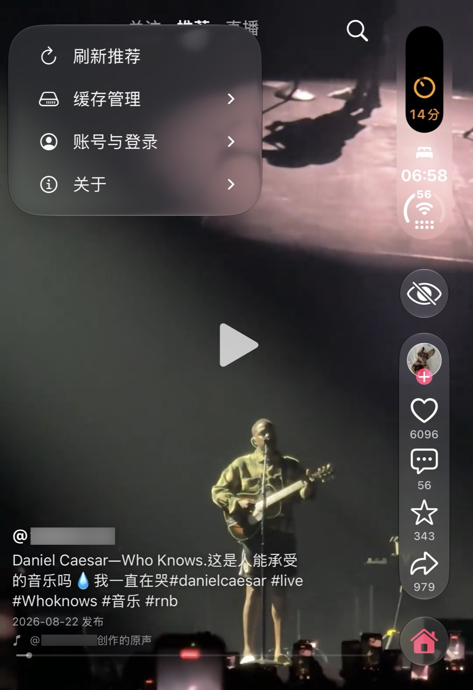
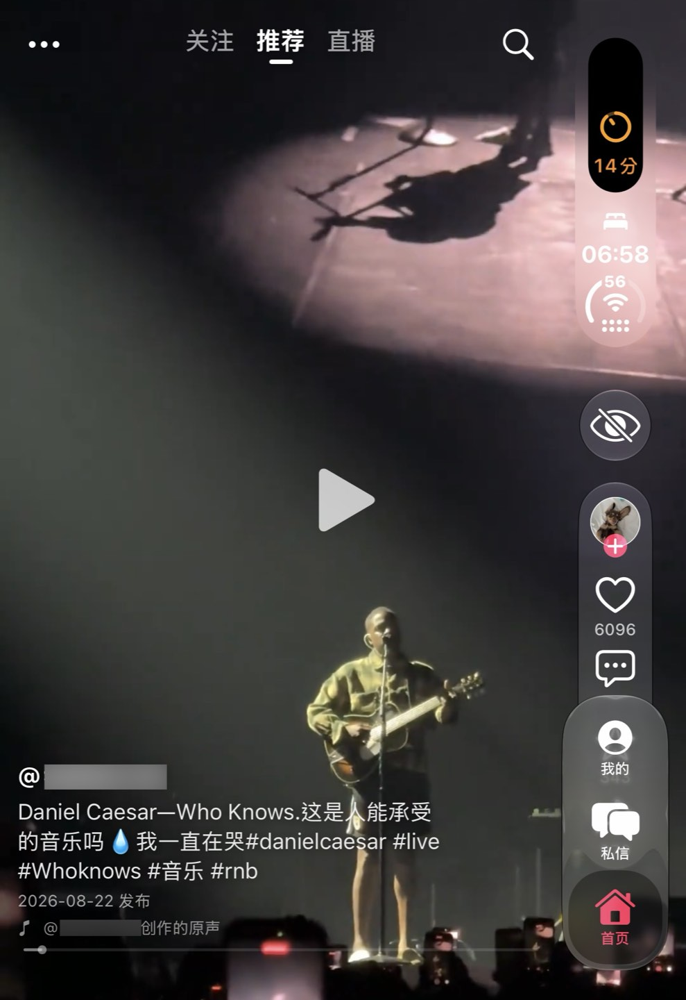
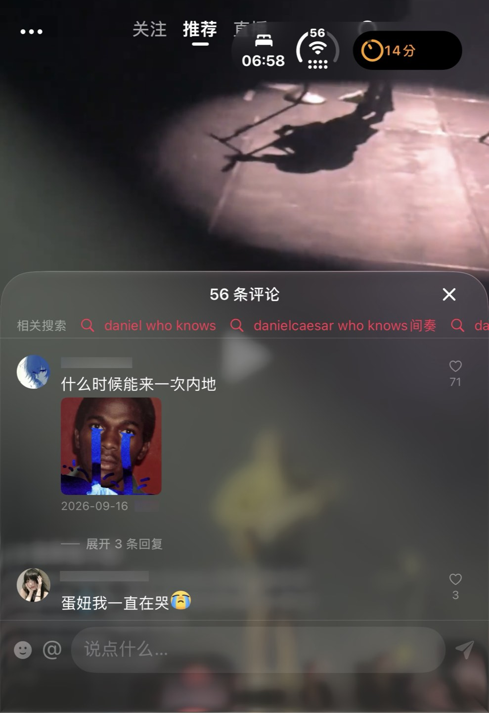
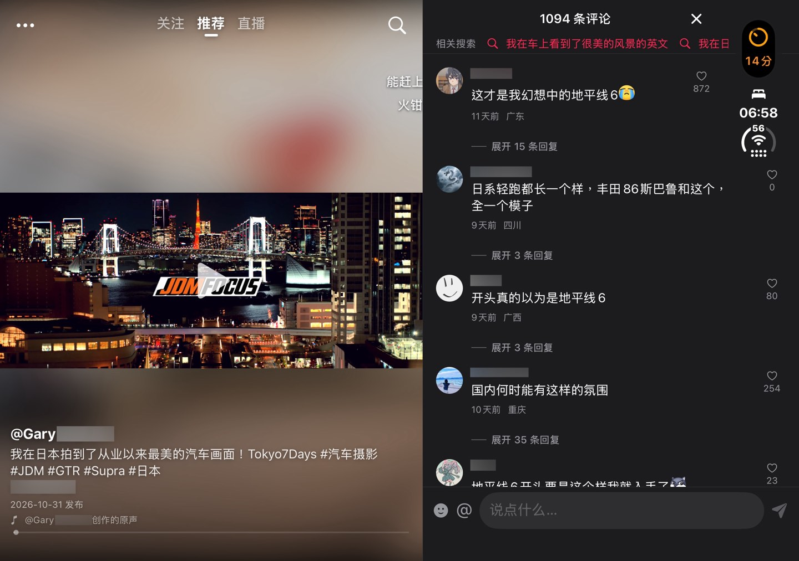
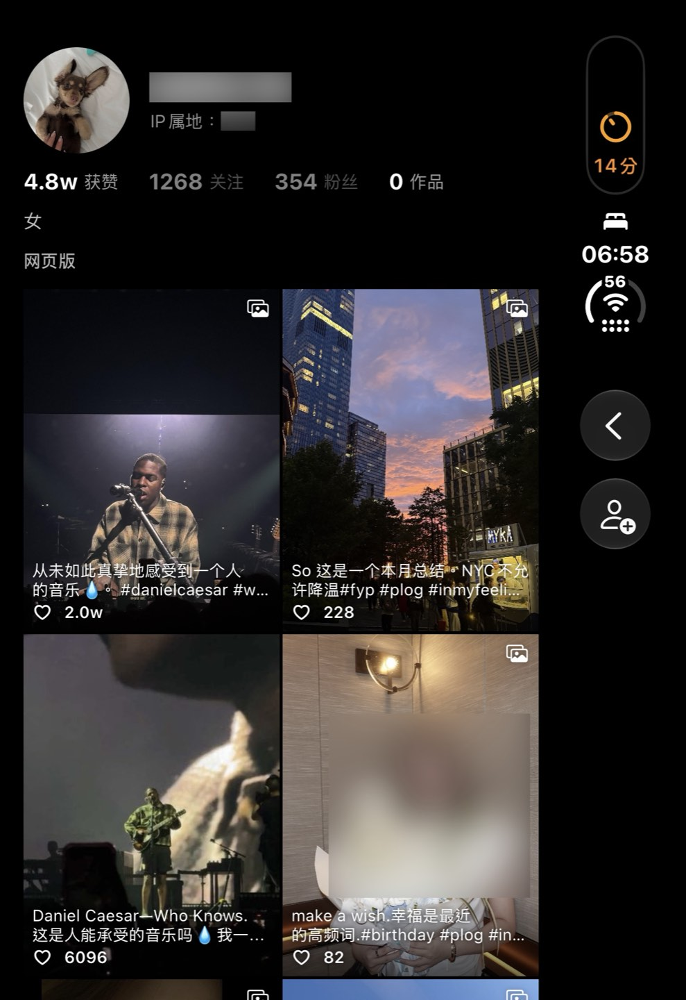
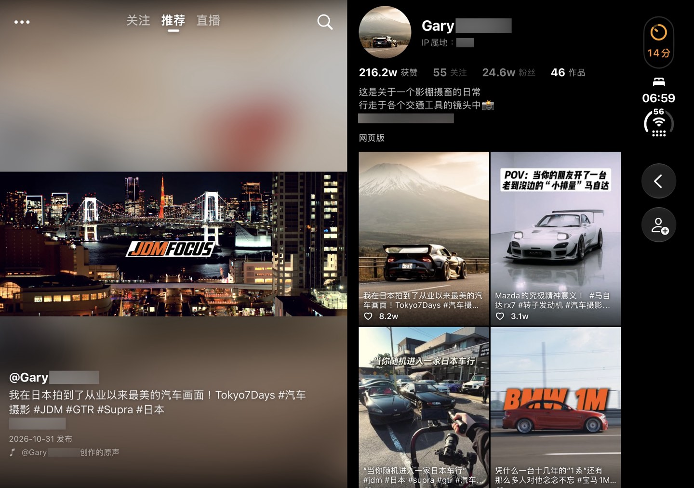
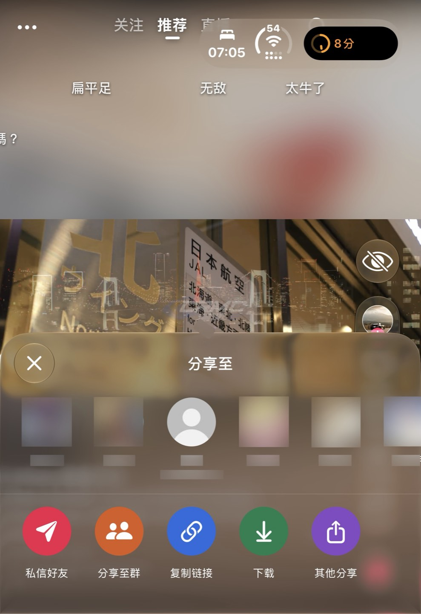
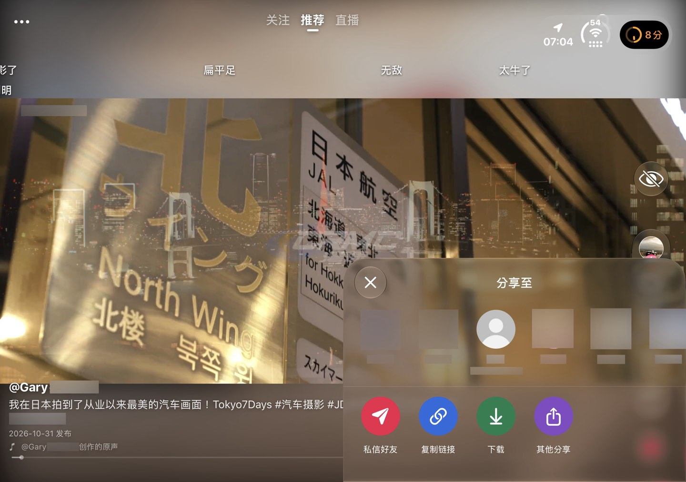
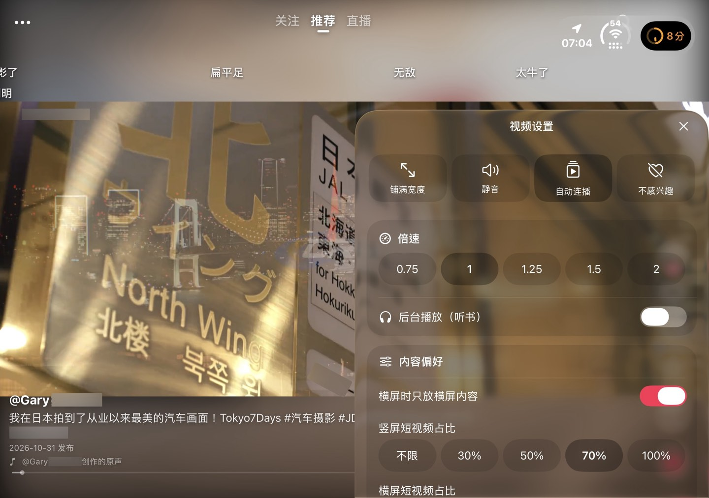
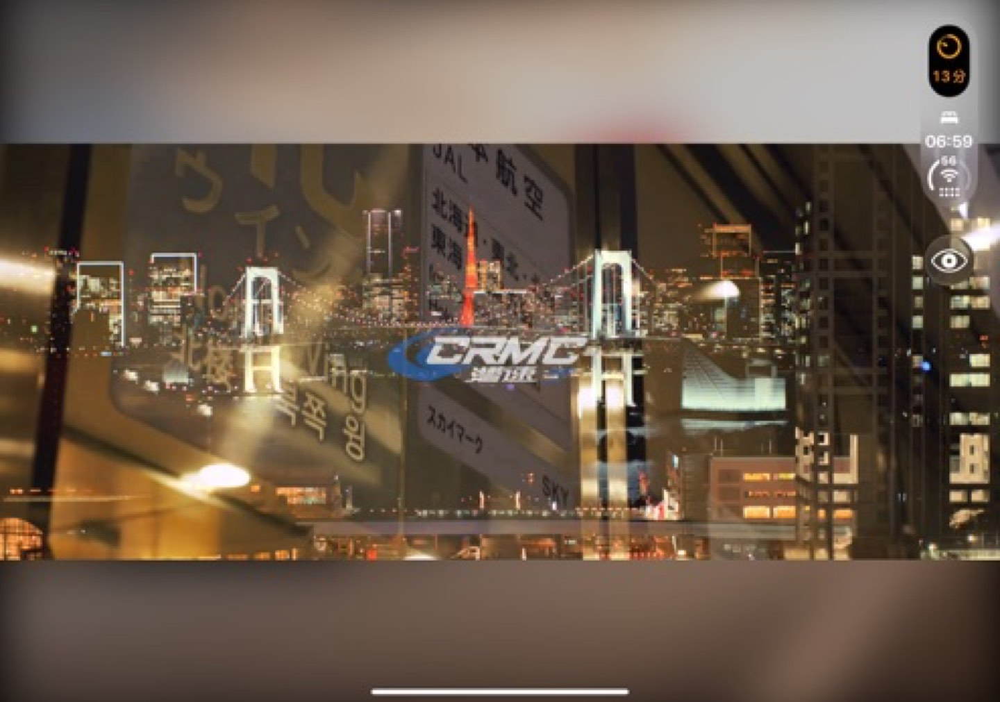

# DouDuo 经典布局

**基于上游 DouDuo v1.5.5（106）**。在「更多 → 设置 → 界面模式 → 经典」开启。本分支的布局改动仅适用于经典模式。上游版本说明见 [v1.5.5 发行说明](https://github.com/81199000/DouDuo/releases/tag/v1.5.5)。

## 支持设备

经典布局需要 iOS 或 iPadOS **27.1 及以上**。App 最低支持 iOS 或 iPadOS 26.0，低于 27.1 时可选默认、简洁和极简布局。

| 设备 | 布局与验证范围 |
| --- | --- |
| iPhone Duo | 主要适配设备。支持外屏、展开后的内屏横竖屏、半折及窄窗口布局。v1.5.5 已在 Device Hub 联网验证外屏和内屏横屏的简介与评论，以及作者作品和搜索视频在合屏后继续播放。也验证了外屏有实时活动时，作品页和首页的互动按钮可用。 |
| iPhone 18 Pro Max | 早期版本在 Device Hub 做过竖屏基础回归，覆盖顶部按钮、互动栏、评论、简介和清屏。 |
| iPad Pro 11 英寸 | 早期版本在 Device Hub 做过横屏基础回归，覆盖系统页签避让、互动栏和右侧简介／评论面板。 |

## 经典布局功能

### 一、Dock 与互动栏

- 使用系统 `TabView` 分隔“我的／私信／首页”，竖向顺序固定为我的、私信、首页；移除我的、私信根页面的返回按钮，保留二级页面返回。
- 首页通过系统工具栏空间分配和压缩优先级，使 Dock 默认收起；点击当前栏目可展开系统选择器。仅 Dock 选中项采用与开关一致的主题红色，其他按钮颜色不受影响。收缩仍由系统布局决定，并非私有 API 强制隐藏。
- Dock 只负责页面导航：已在首页时重复点击不刷新推荐、不切换当前视频；从我的／消息返回首页保留当前视频。系统选择器的展开与收起仍由系统处理。
- 互动栏统一包含头像、点赞、评论、收藏、分享；使用紧凑的液态玻璃胶囊，分享采用空心图标，去除图标后方阴影。
- 普通 iPhone 竖屏和 iPad 的经典互动栏下移到简介附近，并为底部系统栏保留空间；紧凑高度的手机横屏仍使用居中排布。清屏按钮下移到频道栏下方，避开搜索；顶部频道栏跟随内容安全区避让 iPad 系统页签。
- 头像下方复用上游不透明红色关注加号，点击即可关注；已关注作者不显示加号，头像和作者页的关注状态同步。
- 非首页作品播放器复用同一组互动操作，返回按钮与互动胶囊分离，互动栏放在系统侧栏下方，避免实时活动挤压后收进“更多”。不再提供下方的更多入口。
- 进入直播间隐藏应用的 Dock、侧栏操作和顶部频道栏，退出直播间恢复；系统时间和实时活动由系统管理。

### 二、视频播放与清屏

- 清屏按钮使用 `eye.slash` / `eye`；开启后隐藏应用的顶栏、Dock、互动栏、简介、进度条与弹幕，只保留视频和退出清屏按钮。系统状态信息仍由系统管理。
- 清屏状态退出 App 时，支持系统画中画的 AVPlayer 视频可继续小窗播放；普通视频仍遵循既有后台播放开关。VLC 回退播放器暂不支持画中画。
- 双指捏合切换原比例与铺满宽度偏好，松手后视频回正；并非任意倍率缩放。视频未覆盖的区域用模糊封面填充，各视频入口保持一致。
- 打开分享面板和长按菜单不主动暂停或恢复视频，保留用户原本的播放／暂停状态。
- 内屏并排打开作者页时，左侧视频继续播放；进入作者作品的全屏播放器时停止底层视频，退出作品后恢复原页面。

### 三、视频布局与手势

#### 1. 视频简介与进度条

调整作者名、简介、发布时间／声明、音乐与进度条的位置、字号、字重和颜色，区分信息权重。简介预览最多三行，截断时在末行提供「展开」；底部内容避开系统退出条。

#### 2. 固定顶栏

左侧更多按钮提供播放操作及设置入口，中间依次为直播、关注、推荐，右侧为搜索。顶栏不随视频分页消失。经典布局下，点击已选中的“推荐”刷新推荐流；从其他频道点击则只切回推荐，滑动切换频道也不刷新。连续点击刷新时不会并行发起多次刷新，获取不到新内容时保留当前视频。设置页的“刷新推荐”沿用同一套数据加载与替换逻辑。默认、简洁、极简布局的顶部点击行为不变。

#### 3. 分享与评论面板

- 在原有原生分享功能上重做布局与材质：第一排联系人，第二排私信、群分享、复制链接、下载、其他分享等操作，按钮增加颜色；具体项随联系人及登录状态显示。
- 外屏评论和分享面板贴齐左右及下边缘；内屏分享位于右下角，宽度为全屏一半，第二排高度与外屏保持一致。面板外部不再叠加暗色蒙版。
- 评论标题替代顶部拖动横条，相关搜索放在标题下方；修正输入区遮罩、裁剪和底部安全距离。
- 评论支持标题区下拉、列表顶部下拉，以及评论列表右滑关闭。列表中段上下滚动不触发关闭，相关搜索横向滚动保留自身行为。
- 内屏大横屏评论使用纯色侧栏，打开时隐藏视频互动栏与 Dock；半折自动打开的常驻评论采用相同隐藏规则。
- 经典布局内，推荐、关注、我的、搜索及作者作品共用评论呈现规则；默认、简洁和极简布局保留上游评论排版及系统弹窗，相关搜索仍在列表下方。评论加载、回复、发送和图片浏览逻辑共用。

#### 4. 长按菜单

视频设置面板集中显示当前视频的快捷操作、倍速和发弹幕入口，全局偏好可从「更多 → 设置」进入；保留现有设置值与业务功能。使用一致的材质、选中加深背景和分段选择样式，移除首排按钮最后方的整块背景。

以实际窗口全宽计算：左右各约 30% 长按倍速，中间约 40% 长按打开菜单；系统状态列不再缩窄分区基准。菜单支持标题区下拉及列表顶部下拉关闭，与评论共用手势规则。

#### 5. 作者页与导航手势

推荐页左滑、点击头像或作者名进入作者页；内屏作者页在右侧并排显示。关注、返回按钮交由系统工具栏安排，并隐藏 Dock。关注页左滑返回推荐。

#### 6. 手势协调与反馈

- 修复上下拖动视频后不松手时误触长按倍速。
- 视频区域横向滑动用于页面导航，保留进度条自身拖动定位，移除整屏横滑拖进度。
- 点赞、长按倍速增加震动反馈；双指操作与单指导航、倍速手势互斥。

### 布局与功能截图

以下为 v1.3.12 定制版的参考截图，展示经典布局的主要变化，已对部分显示内容模糊处理；当前版本界面请参阅下方更新截图。

#### 首页与系统 Dock

固定顶栏、头像关注加号及紧凑互动胶囊；仅 Dock 选中项为红色。第二张展示点击后的系统展开状态，此时 Dock 会临时覆盖部分互动区域。

#### 评论：外屏与内屏

外屏使用贴边玻璃面板；内屏沿用普通材质侧栏。相关搜索置于评论标题下方，内屏打开评论时隐藏 Dock 与视频互动栏。支持下拉及右滑关闭；半折自动评论为常驻布局。

#### 作者页：外屏与内屏

外屏显示作者作品页；内屏右侧显示作者资料与作品，左侧视频继续播放。返回、关注由系统工具栏安排；进入作者作品后停止底层视频，避免双路播放。

#### 分享：外屏与内屏

保留原有联系人与分享能力，整理为两排；第二排为私信、群分享、复制链接、下载及其他分享。内屏面板位于右下角，占屏幕宽度一半、底部贴边，打开时保持视频原播放状态。

#### 长按视频设置

屏幕中间约 40% 长按打开菜单，左右各约 30% 长按倍速。图中为早期的播放、内容偏好及弹幕设置，选中项加深背景；菜单支持下拉关闭，打开期间不暂停视频。

#### 清屏模式

隐藏应用的顶栏、Dock、互动栏、简介、进度条与弹幕，仅保留视频及退出清屏按钮；系统状态栏与实时活动仍由系统管理。画中画适用于支持该功能的 AVPlayer 视频。

## v1.5.5 更新与截图

### 评论、简介与视频位置

- **外屏和窄窗口**：手动打开评论或展开简介时，横屏视频按原比例上移至窗口顶部，顶部频道栏随之隐藏，面板贴在视频下方。竖屏视频和图集留在原位，面板从底部展开。Duo 的状态信息在窄窗口面板打开时收起，关闭后恢复。顶部频道栏、互动栏和 Dock 也按当前视频布局恢复。
- **内屏大横屏**：视频留在左侧，右侧面板跟随当前视频更新。系统状态栏横向放在面板头部，右侧评论的点赞按钮有独立空间。「相关搜索」位于「XX 条评论」正下方。
- **半折**：视频与常驻评论沿折痕分配空间。展开状态下的手动评论和简介按当前窗口布局。
- **简介**：点击正文即可展开，点击标签进入搜索。加粗的「展开」接在预览末行。展开区域依次显示作者与关注入口、完整简介与发布时间、共用评论列表。标签使用主题强调色，内屏大横屏的作者名与「关注」在头像右侧分两行。简介和评论之间用一条线分隔。
- **输入与关闭**：评论输入框随键盘调整。手动打开的面板可用关闭按钮或下拉关闭，评论列表也支持右滑关闭。

以下图片沿用已压缩和去敏的 PR 附件，展示对应布局。部分截图取自早期测试版，按钮和系统状态信息以当前版本为准。

#### Duo 窄窗口

左图为横屏视频上移后的评论区，右图为同一布局下的展开简介。

#### Duo 内屏大横屏

左图为右侧评论，右图为右侧完整简介和评论。两图均展示横向状态信息。

### 互动栏、Dock 和顶部频道栏

- 经典互动栏包含头像、点赞、评论、收藏和分享。头像下方的加号可直接关注作者。内屏大竖屏、普通 iPhone 竖屏及 iPad 的互动栏靠近视频简介。作者作品和搜索结果等播放器也提供这组操作，清屏位于返回按钮下方。
- Duo 内屏打开作者作品后即使翻过一条再合屏，也会在外屏保留当前作品。搜索视频同样会在合屏后保留，退出播放器即可回到原搜索结果。
- 「我的／消息／首页」使用系统 Dock。已在首页时再次点击「首页」，系统可以展开页面选择器，当前视频和滚动位置保留。从「我的」或「消息」可切回首页。参见 [Issue #31](https://github.com/81199000/DouDuo/issues/31)。
- 点击顶部已选中的「推荐」会刷新推荐流。从其他频道切回推荐时继续上次观看位置。刷新期间再次点击共用同一次请求，没有取到新内容时继续显示当前视频。
- Duo 内屏大竖屏的频道栏固定在顶部，搜索按钮避开侧边状态栏。iPad 顶部频道栏避开系统页签，横屏右侧面板的关闭按钮避开状态栏。非 Duo 顶部「更多」按钮的点击修复见 [Issue #29](https://github.com/81199000/DouDuo/issues/29)。

#### Duo 首页与作品页

作品页保留当前视频的互动入口，返回和清屏上下排列。内屏大竖屏首页可同时看到顶部频道栏与底部 Dock。

### 清屏、长按与分享

- **清屏**：收起频道栏、Dock、简介、进度条、互动栏和弹幕。点清屏按钮可恢复。支持画中画的 AVPlayer 视频可在清屏后退到小窗，VLC 回退播放不提供画中画。
- **长按**：视频两侧长按加速，中间长按打开「视频设置」。右侧互动区域也支持长按加速。视频设置面板贴底，按快捷按钮、倍速和发弹幕等实际内容收紧高度。空间不足时可以滚动。
- **分享**：面板上方是联系人，下方是分享操作。窄窗口底部贴边，宽窗口位于右下方。可用操作取决于登录状态和当前作品。打开面板时保留视频原来的播放或暂停状态。
- **播放手势**：双指捏合用于切换画面适配方式。拖动底部进度条可定位，视频区域的横向滑动用于切换频道或打开作者页。
- **直播与外观**：进入直播间后收起应用的顶部频道栏、Dock 和视频操作，退出直播间时恢复。外观可跟随系统，也可手动选择亮色或暗色。

### 非 Duo 布局预览

iPhone 18 Pro Max 竖屏的首页和评论区。

iPad Pro 11 英寸横屏的首页与右侧简介／评论面板。

## 致谢

感谢项目维护者 [@81199000](https://github.com/81199000) 持续更新 DouDuo，也感谢每一位提交 PR、报告问题和参与讨论的朋友。

一开始我想给 Duo 做一个第三方客户端，动手后才发现从播放到交互有很多细节要一一解决。后来找到 DouDuo，我开始在这个项目上尝试自己的布局。第一次提交经典布局时只是抱着试一试的心态，没想到维护者给了详细建议，调整后的实现也随 v1.3.15 发布了。此后，标签与搜索、私信页布局、亮色模式也陆续合入。看到 DouDuo 越来越接近我想在 Duo 上使用的样子，很感谢大家一路给出的建议、优化和反馈。相关记录见 [PR #17](https://github.com/81199000/DouDuo/pull/17)、[PR #24](https://github.com/81199000/DouDuo/pull/24)、[PR #30](https://github.com/81199000/DouDuo/pull/30) 和 [PR #36](https://github.com/81199000/DouDuo/pull/36)。

**贡献者：[@zenghongjvn](https://github.com/zenghongjvn)**
