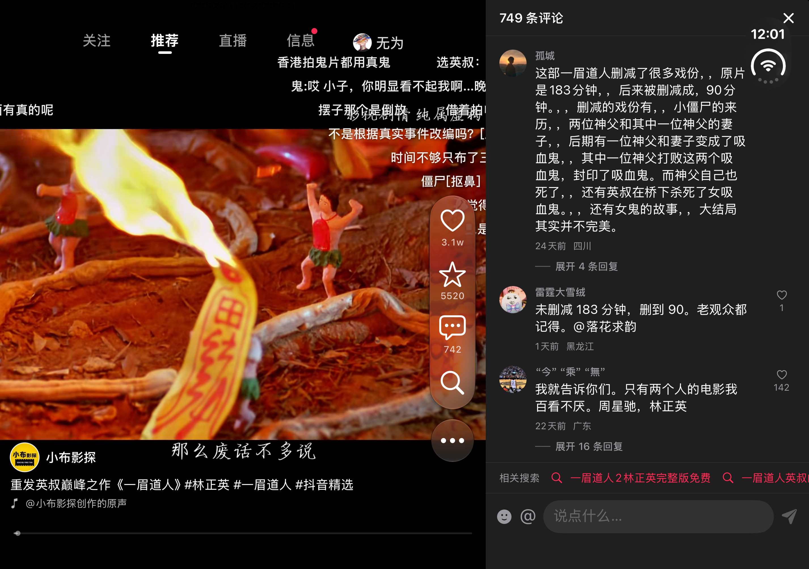
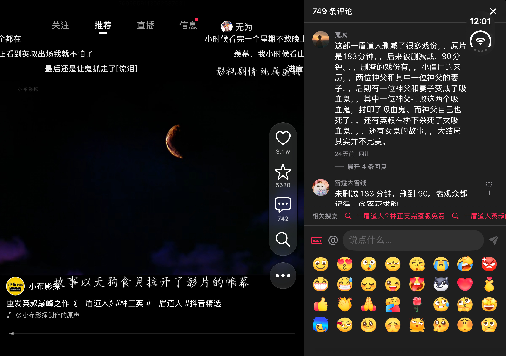
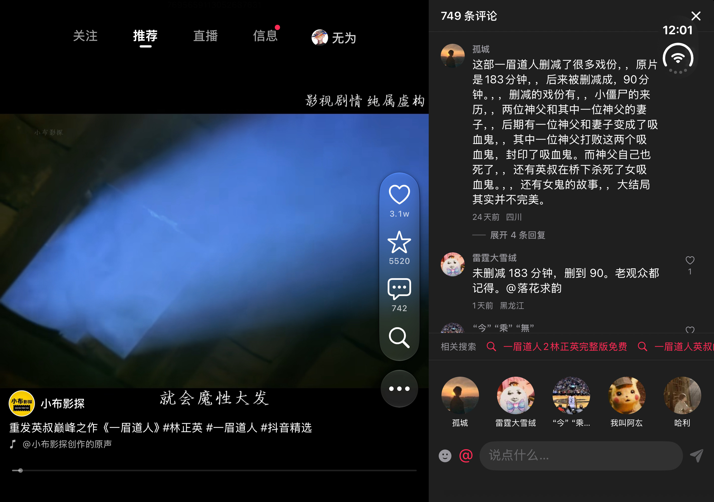
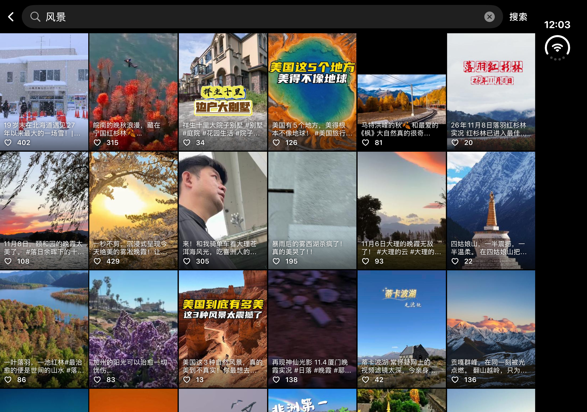
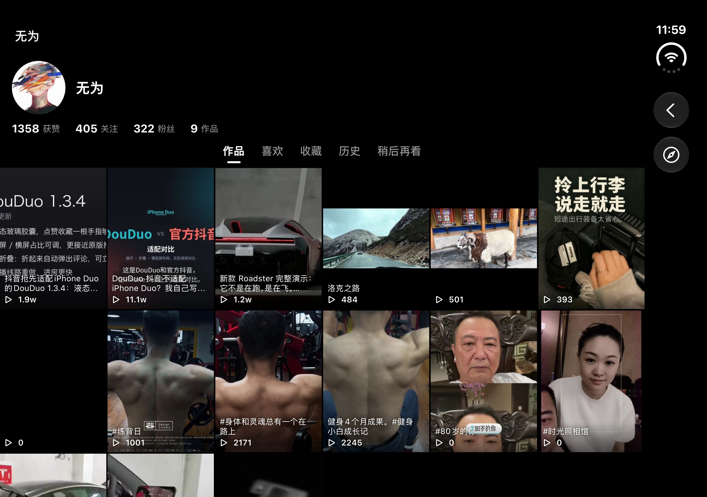
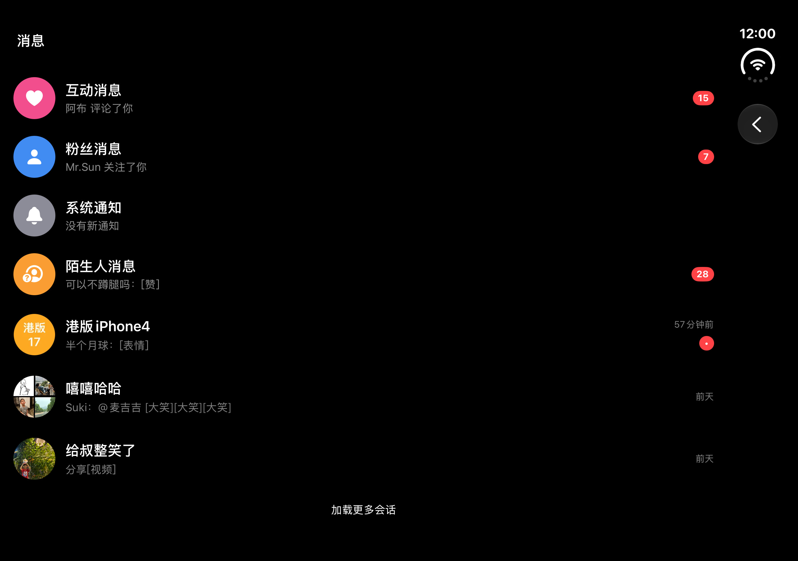
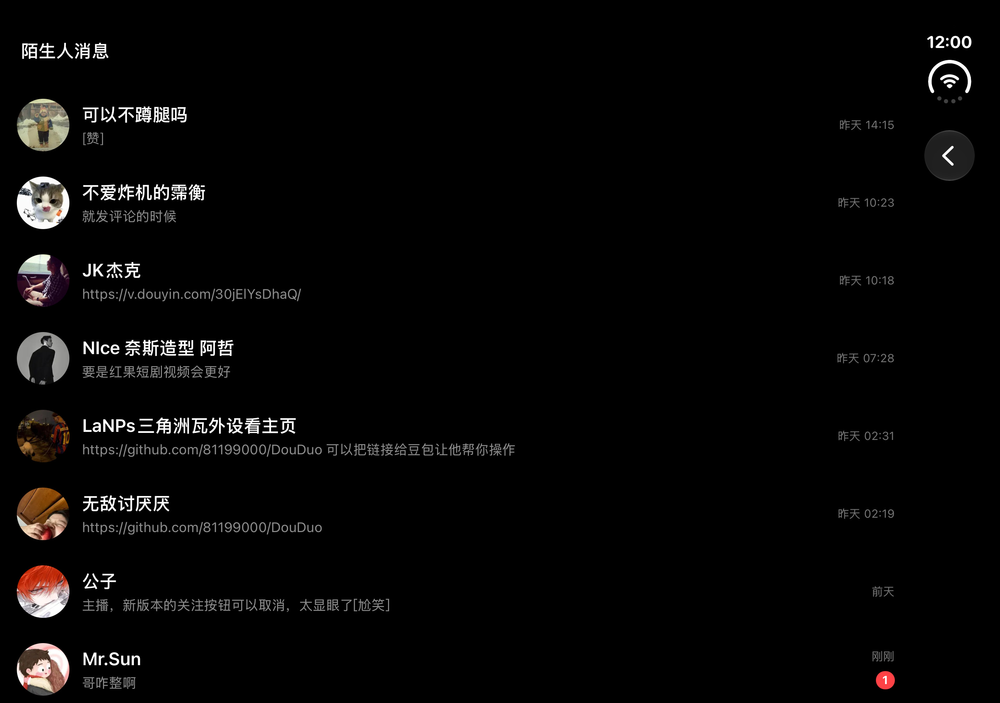
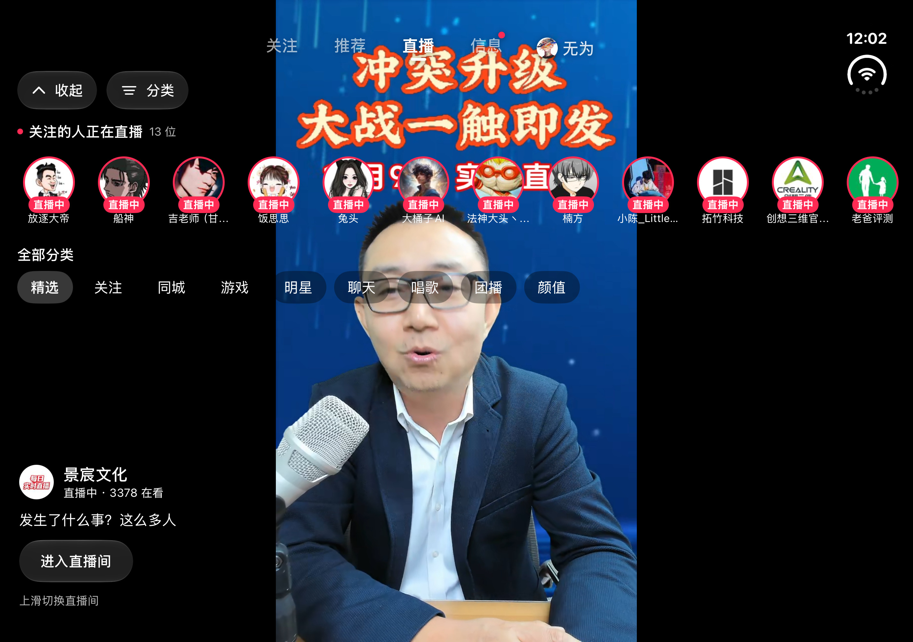
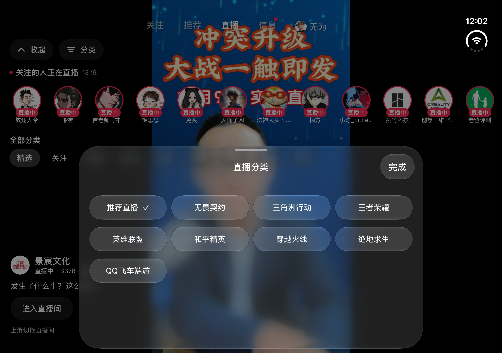
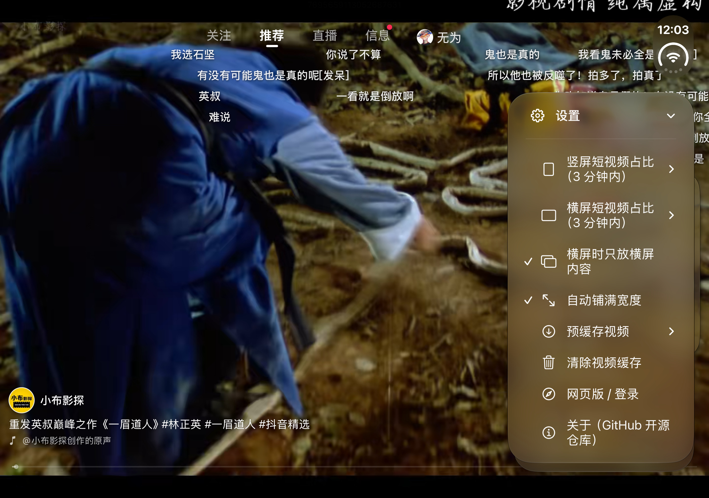

# DouDuo 功能截图

以下为 **v1.3.7（53）** 在 **iPhone Duo / iOS 27.2 模拟器内屏**中的真实运行截图；全部重新采集，**未打码、未拼造 App 内容**。点击图片可查看原始分辨率。

## 推荐播放与评论

### 推荐流
[](feed.jpg)

### 侧边评论栏
[](comments.jpg)

### 抖音表情面板
[](emoji.jpg)

### @ 用户选择
[](mentions.jpg)

## 搜索、个人页与消息

### 搜索结果
[](search.jpg)

### 我的作品与播放量
[](mine.jpg)

### 消息中心与会话列表
[](messages.jpg)

### 陌生人消息分类
[](strangers.jpg)

## 直播

### 直播预览
[](live.jpg)

### 直播发现与关注主播
[](live-discovery.jpg)

### 游戏专区分类
[](live-categories.jpg)

### 原生直播间
[](live-room.jpg)

## 设置

[](settings.jpg)

## 截图来源与复现

- 共 13 张；尺寸及 SHA-256 记录在 [manifest.json](manifest.json)。
- 截图使用真实账号会话和实时内容，未发送评论、私信或执行点赞、收藏操作；查看页面可能触发 App 正常的已读更新。
- Duo 有两块显示面：XCTest 的 `app.screenshot()` 可能拿到未点亮的外屏，因此由 UI 测试发出截图标记，主机使用 `simctl io ... screenshot --display=3` 采集活动内屏。
- 复现命令（先确认模拟器 UUID、活动显示 ID 和账号已登录；输出放在本机 scratch，不入库）：

```bash
python3 scripts/capture_release_screenshots.py \
  --device <SIMULATOR_UUID> --display <ACTIVE_DISPLAY_ID> \
  --output <SCRATCH_DIRECTORY>
```

本次只更新截图、文档与截图测试，不改变 App 功能，也不另发安装包。
